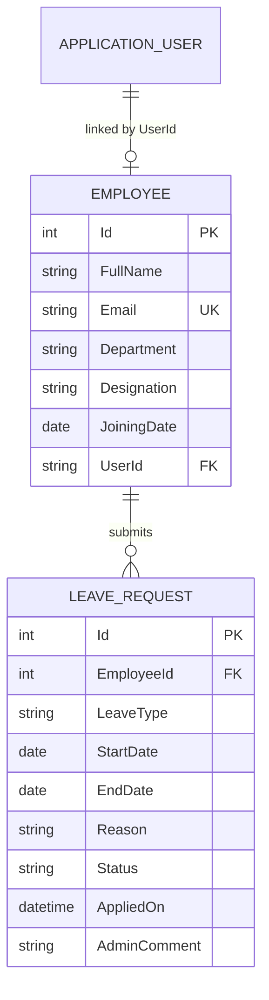

# Database Design

## Entities
- `AspNetUsers` and related Identity tables: authentication accounts, password hashes and roles.
- `Employees`: employee profile with unique email; optional one-to-one link to an Identity user.
- `LeaveRequests`: leave details linked to an employee.

## Relationships
- One Identity user can be linked to zero or one employee profile.
- One employee can have many leave requests.
- Employee deletion is restricted when leave history exists.

